# Wolf MC Panel

**Your Minecraft servers. Your PC. One friendly control panel.**

A free, open-source Minecraft Java server manager for **Windows x64**. Create local servers, manage mods, watch the console, control players and protect your worlds with backups, from your browser.

[Download for Windows](https://github.com/Lobodk/wolf-mc-panel/releases/latest) · [Guía en español](docs/README.es.md) · [Hosting guide](docs/HOSTING.md) · [Support on Ko-fi](https://ko-fi.com/lobo97)

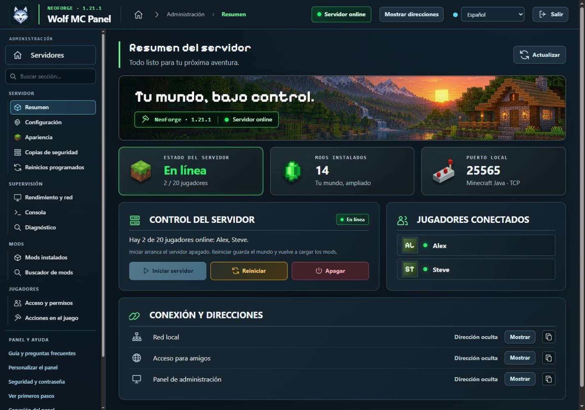

## What you can do

- **Run several independent servers.** A home screen lists your servers, with creation, management, connection settings and a recoverable delete flow. Each server has its own world, settings, mods, game port and RCON port.
- **Choose Minecraft and a loader.** Version catalogs come from Mojang, NeoForge, Forge and Fabric. Install vanilla first or select an available loader during creation. New releases appear when the provider publishes them; compatibility is checked for your selection.
- **Control the server.** Start, stop and restart; view the console; manage whitelist, operators, kicks and bans; configure difficulty, RAM, view distance and simulation distance.
- **Manage mods.** Upload JARs manually, identify installed mods, search CurseForge, review dependencies and find compatible updates. Queue additions, removals and updates while Minecraft is running, then apply them on restart. Download progress shows percentages and transferred bytes.
- **Back up and restore.** Manual copies and optional four-hour automatic backups are queued safely. Automatic backup rotation avoids accumulating endless archives. Restore from the panel with a safety copy of the current state.
- **Monitor your server.** Performance, network information, diagnostics, tasks and recent panel actions in one interface. Some live data and modded-item catalogs require a compatible telemetry/registry bridge.
- **Personalize the experience.** Panel name and PNG logo, server icon, visual MOTD editor, decorative text styles, colors, gradients and a preview. Minecraft's client and resource pack determine the final font rendering.
- **Use your preferred language.** Spanish is the default; English, German, French, Turkish and Brazilian Portuguese are selectable in the panel and built-in guide. Game logs and third-party mod descriptions retain their original language. Translation improvements are welcome.
- **Choose how to host.** Local-only by default; optional access over your LAN or your own HTTPS domain. The Windows installer bundles Node.js and Caddy. You can also run the source directly on Windows.
- **Move a server between Windows PCs.** Pair a second PC once with the tool generated by the panel. Then move the world, mods and settings from the same dashboard.

## See the panel

Screenshots show Wolf MC Panel 1.0.8 with demonstration data. The interface is shown in Spanish or English; six languages are available. Server state and available actions depend on your installation.

### Your servers and the creation wizard

Keep independent servers together and choose Minecraft, a loader and connection settings step by step.

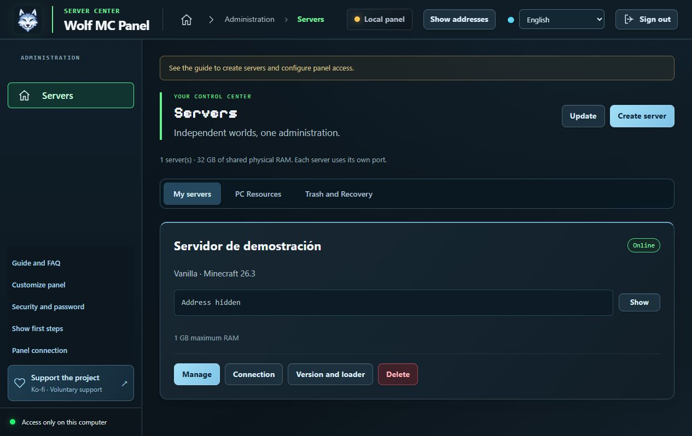

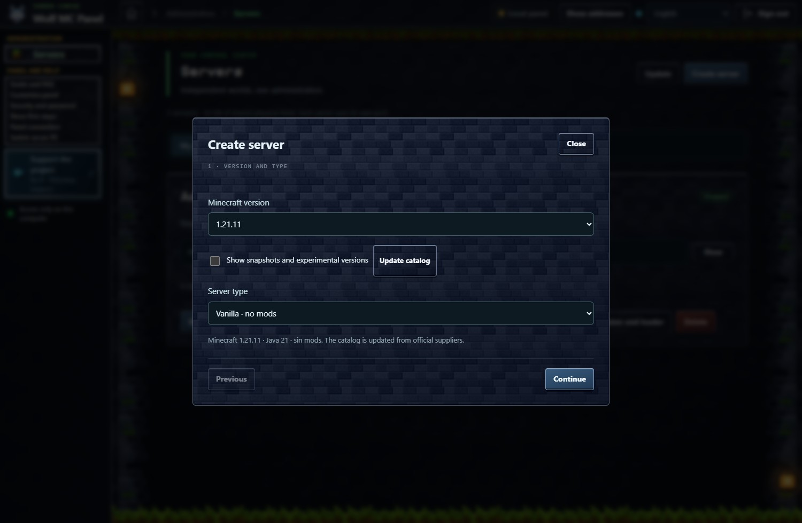

### Appearance and configuration

Preview a server description with decorative text, colors and gradients, then adjust gameplay, memory and access settings.

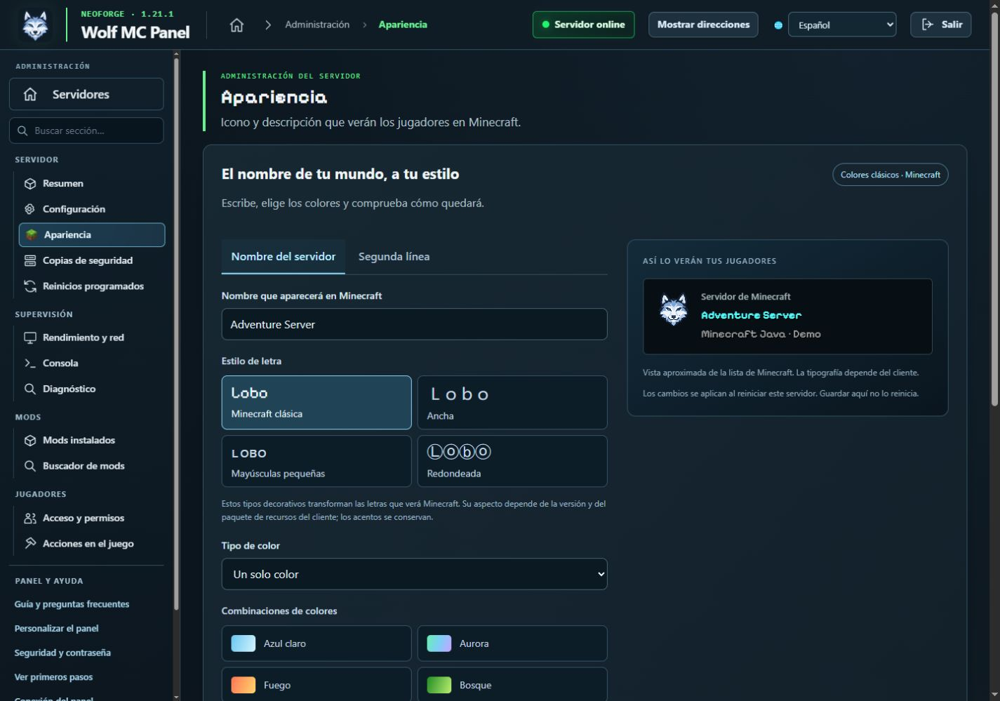

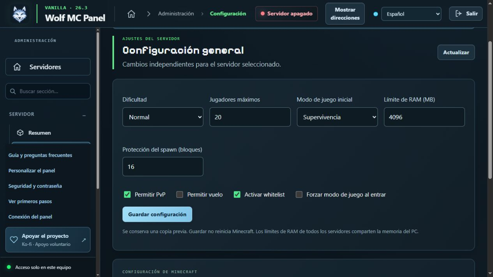

### Player access and searchable enchanted books

Manage whitelist and operators, or find items and books by their translated names and enchantment levels.

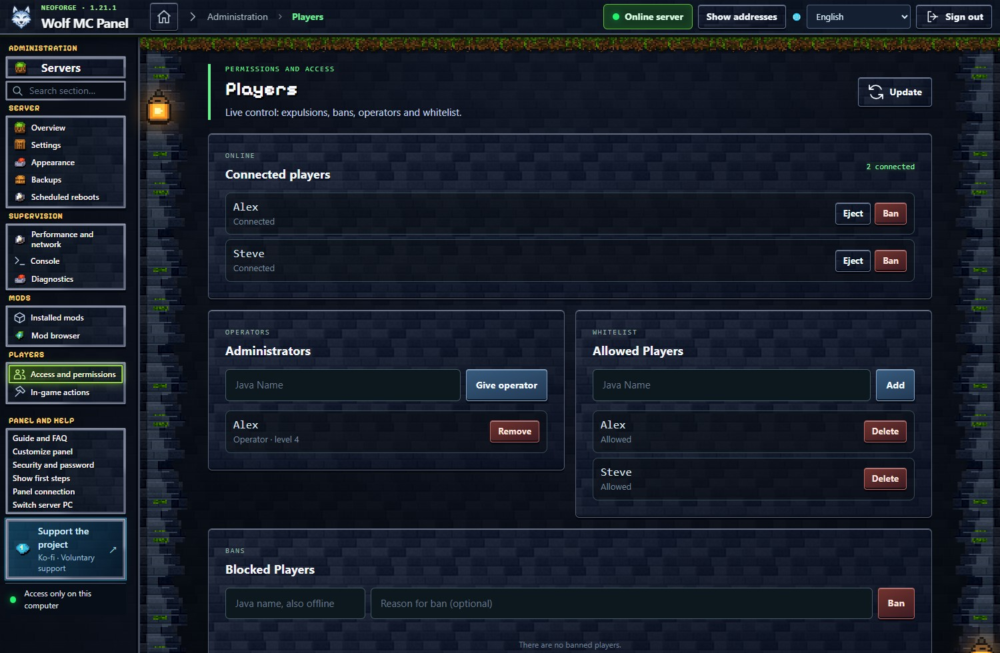

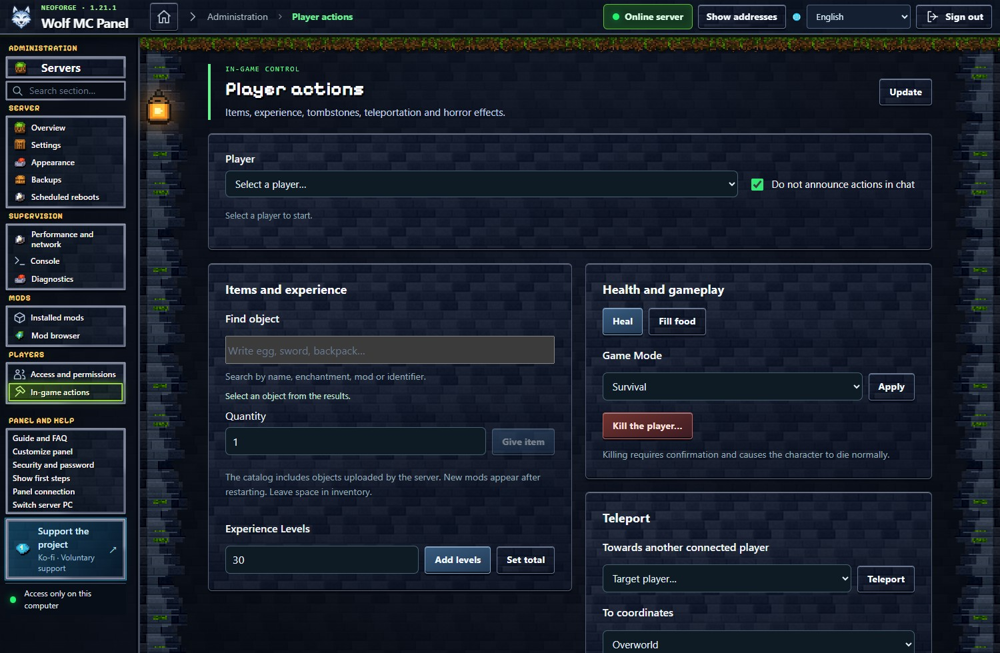

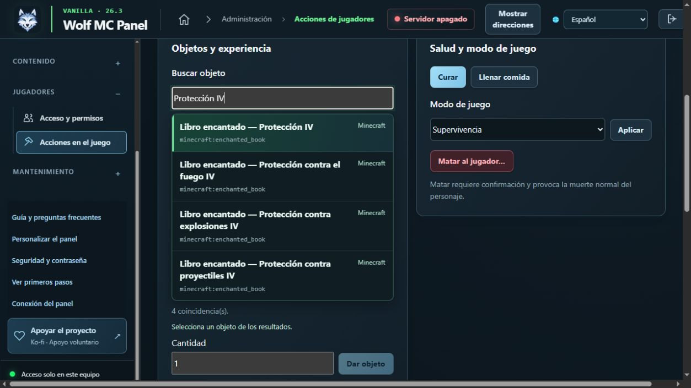

### Performance and built-in help

Review server performance and follow the setup guide, hosting explanations and FAQ. The first-run tour points new users to that help.

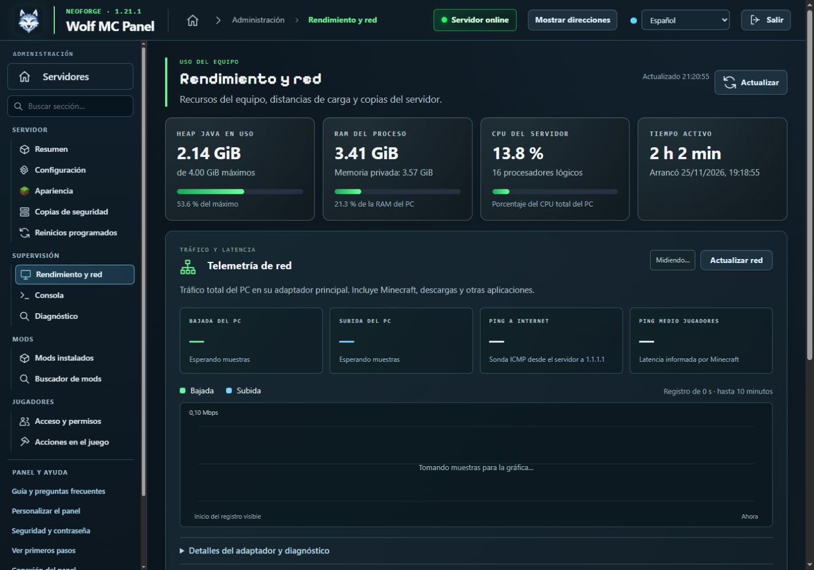

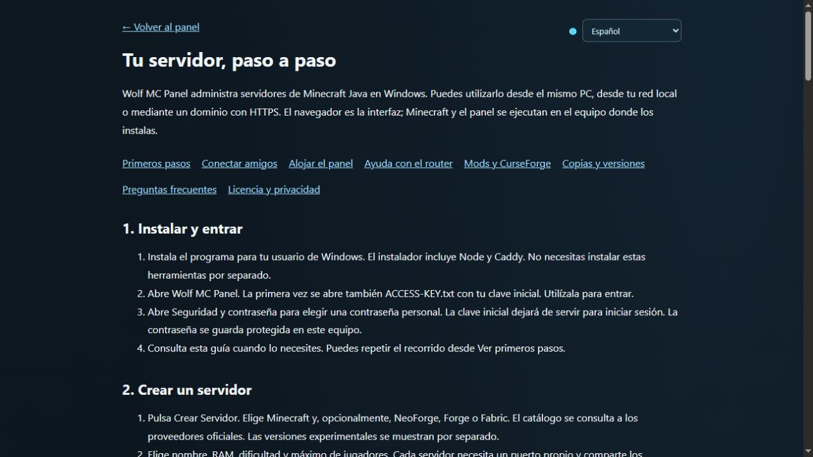

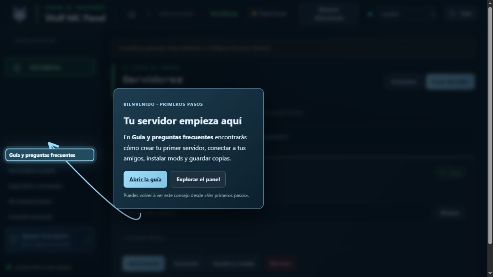

### Local password recovery

The sign-in screen explains recovery. The Windows shortcut requires a local confirmation and preserves your Minecraft servers and worlds.

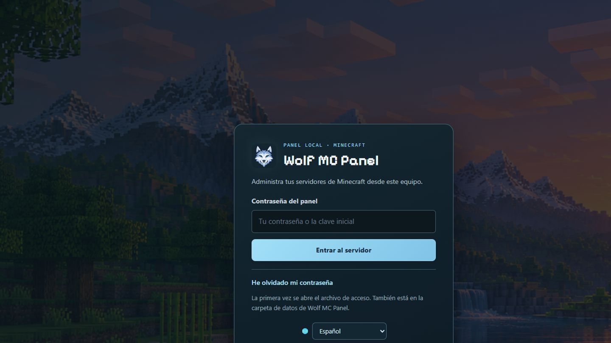

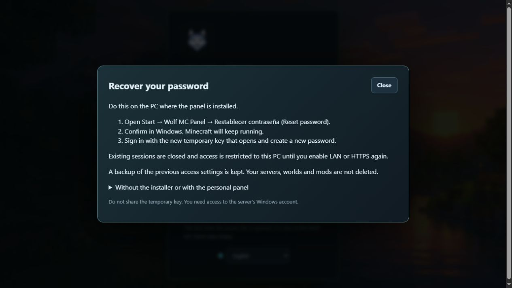

## Install and get started

1. Download the Windows x64 installer from [Releases](https://github.com/Lobodk/wolf-mc-panel/releases/latest). Compare its SHA-256 with the checksums attached to that release.
2. Install for your Windows user. Everyday operation does **not** require administrator rights. A requested firewall change may need elevation separately.
3. Open **Wolf MC Panel**. Your default browser opens the panel. On the first launch, a local access-key file opens too.
4. Sign in with that initial key, then choose **Security and password** to set your own password. Its salted scrypt hash is stored on your PC; the initial key can no longer sign in afterward.
5. Click **Create server**, choose a version and optional loader, set resources and connection details, then read and accept Minecraft's EULA if you agree. The panel downloads the required server files and Java.
6. Open the prepared server and start it. Test locally before connecting friends from outside your network.

If you forget your password, choose **I forgot my password** on the sign-in screen. On the server PC, run **Start → Wolf MC Panel → Restablecer contraseña**. Recovery creates a new temporary key, closes panel sessions and limits access to that PC until you set a password and re-enable LAN or HTTPS. It preserves Minecraft servers and worlds. [Recovery instructions](docs/HOSTING.md#forgotten-password).

The guided first-run tour points you to the built-in guide and FAQ. You can repeat it later. The panel remembers that the tutorial has been shown and the guide has been opened, so dismissed hints do not return on later logins or in another browser. Opening the guide and returning to the panel preserves your signed-in session.

The installer is currently unsigned. Windows may display its normal publisher/reputation warning. Obtain it from this repository and verify the checksum; do not disable your security protections. It does not bundle Minecraft, Java, modpacks, paid services or another person's API key.

## Play address and panel address

These are separate services:

| Purpose | Example | Who should use it? |
| --- | --- | --- |
| Minecraft game | play.example.org:25565 | Your players |
| LAN administration | http://your-server-pc:8787 | Administrators on your trusted LAN |
| HTTPS administration | https://panel.example.org | Administrators with your panel password |
| RCON | Internal, separate port | The panel only; do not forward it on your router |

A domain/DDNS name does not open ports or bypass CG-NAT. To let friends connect, configure the game port on your firewall/router or use a compatible third-party tunnel. The guide explains the choices and links to official router support. The panel can request a firewall rule or UPnP mapping when you ask, but cannot override your operator or router.

Install the panel on a Windows PC that stays on. Open its web address from your main PC, phone or laptop. It can also manage a selected Minecraft server on a paired Windows PC over the LAN. Ordinary PHP-only shared hosting cannot run the Node and Java processes.

## Move Minecraft to another PC

1. Select a managed server and open **Cambiar PC del servidor**. Select the panel PC's LAN address and click **Descargar herramienta**.
2. Open the downloaded **Preparar-WolfMC.cmd** on the destination PC and accept the Windows administrator prompt. The tool configures OpenSSH, encrypted SMB and a scheduled task, then writes **Vinculacion-WolfMC-Windows.json** next to the download.
3. Back in the panel, click **Importar vinculación** and select that file. You can delete the transfer file after pairing. Its SMB credential is encrypted to the panel and is saved on Windows using DPAPI.
4. Use **Trasladar al PC de destino** or **Volver al PC del panel**. The panel saves and stops Minecraft, copies changed files with Robocopy, verifies the result with SHA-256 and starts the verified copy. An interrupted copy can be resumed. An interrupted startup can be retried without copying the world again.

The feature supports one paired server per panel installation, with both PCs on the same private LAN. The server must use Java 9 or newer and listen on all interfaces. The panel PC needs the Windows OpenSSH Client and stays on to forward the original Minecraft TCP port. Keep SSH, SMB and RCON behind your router. Voice chat and other separate UDP ports need their own setup. Existing Windows Firewall rules for Java alone may need the panel's **Firewall de Windows** action to also allow the game relay. The destination tool preserves unrelated OpenSSH installations by stopping the setup when it detects one.

See [HOSTING](docs/HOSTING.md) for local, LAN, HTTPS and recovery instructions.

## Data and backups

Program files and your data are kept separately. Your data is stored in %LOCALAPPDATA%/WolfMCPanel/data. Uninstalling the program preserves data.

Keep an independent copy of your worlds and backups on another disk. A backup on the same disk does not protect against that disk failing. Restoring a snapshot replaces later progress; it does not merge it.

Changing Minecraft or a loader makes a backup first and requires the server to be stopped. It does not automatically convert incompatible mods, preserve removed mod content, or guarantee a world downgrade. Check every mod before a version change. Never test a major upgrade on your only copy.

## CurseForge integration

Manual JAR upload works without an API key. Searching, project metadata, icons and compatible updates through CurseForge require **your own authorized API key**. Request access using the official [application instructions](https://support.curseforge.com/support/solutions/articles/9000208346) and follow [their API terms](https://support.curseforge.com/support/solutions/articles/9000207405-curseforge-3rd-party-api-terms-and-conditions).

No shared key is included. API authorization, rate limits and the mod author's distribution choices can prevent a download. Mods may need to be installed on each client as well. AutoModpack, when independently installed and configured, can help distribute a compatible pack; trust fingerprints belong to each server.

## Run from source

Requirements: Windows x64, PowerShell 5.1+, .NET Framework 4.8 and a current compatible **Node.js 24** release. No npm dependencies are required to run the application.

~~~powershell
node scripts/check-release.cjs
node --test tests/*.test.cjs
node src/main.cjs
~~~

The first launch prints the local panel address. The initial key is written to ACCESS-KEY.txt in the data folder. To use the desktop launcher with a system Node runtime, run node src/desktop.cjs.

| Setting | Purpose |
| --- | --- |
| WOLF_PANEL_DATA | Choose a separate data directory |
| WOLF_PANEL_PORT | Preferred web port; a free nearby port is used if occupied |
| WOLF_CADDY_EXE | Optional absolute path to an official Caddy executable |

Older LOBO_PANEL_DATA and LOBO_PANEL_PORT variables remain compatible. For managed HTTPS in a source installation, obtain the pinned Caddy runtime with scripts/fetch-caddy.ps1, or use your own local reverse proxy.

## Build the Windows installer

Use a JDK 17 or later to rebuild the included registry bridge, an official Windows x64 Node distribution, and Inno Setup 7.1.1 or a compatible newer compiler. Run:

~~~powershell
./scripts/build-windows.ps1 -Iscc 'PATH/TO/ISCC.exe' -NodeDirectory 'PATH/TO/OFFICIAL/NODE' -JavaHome 'PATH/TO/JDK'
~~~

The build verifies source syntax, runs the automated tests, creates icon sizes and the Windows launcher, fetches the pinned Caddy build with a checksum check, and compiles the installer. Build output belongs in dist/ and runtime binaries are not committed to source.

See [test results](docs/TEST-RESULTS.md), [release scope](docs/RELEASE-STATUS.md), [changelog](docs/CHANGELOG.md) and [contributing](CONTRIBUTING.md). Screenshots use an isolated demonstration server, not a user's private world or credentials.

## License, privacy and support

The project's own code is **AGPL-3.0-only**. You may use, study, modify and redistribute it under that license, including its source-sharing obligations for modified network-accessible versions. Third-party components retain their own licenses: see [notices](THIRD-PARTY-NOTICES.md).

There is no advertising, mandatory subscription, or automatic telemetry sent to the creator. External downloads, certificates and integrations contact their respective providers. Read [privacy](docs/PRIVACY.md), [usage and risks](docs/USAGE-AND-RISKS.md), and [security reporting](SECURITY.md).

[Support development on Ko-fi](https://ko-fi.com/lobo97). Support is voluntary; it does not unlock features or promise individual assistance.

**NOT AN OFFICIAL MINECRAFT PRODUCT. NOT APPROVED BY OR ASSOCIATED WITH MOJANG OR MICROSOFT.**
