# Wolf MC Panel

Un panel gratuito y de código abierto para crear y administrar servidores de Minecraft Java en **Windows x64**, desde el navegador.

[Descargar para Windows](https://github.com/Lobodk/wolf-mc-panel/releases/latest) · [Documentación principal](../README.md) · [Apoyar en Ko-fi](https://ko-fi.com/lobo97)

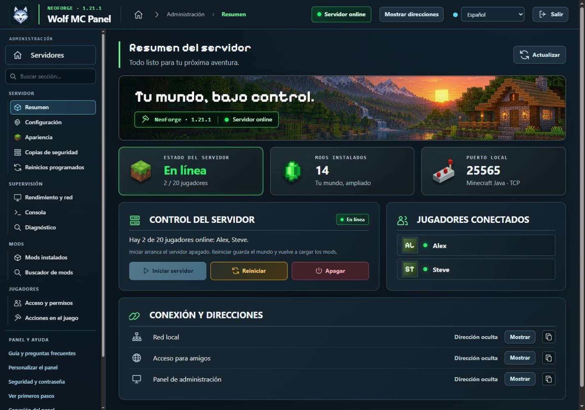

## Así es el panel

Capturas con datos de demostración. Las pantallas pueden verse en español o inglés; el panel dispone de seis idiomas. El estado del servidor y las acciones disponibles dependen de cada instalación.

### Servidores y creación paso a paso

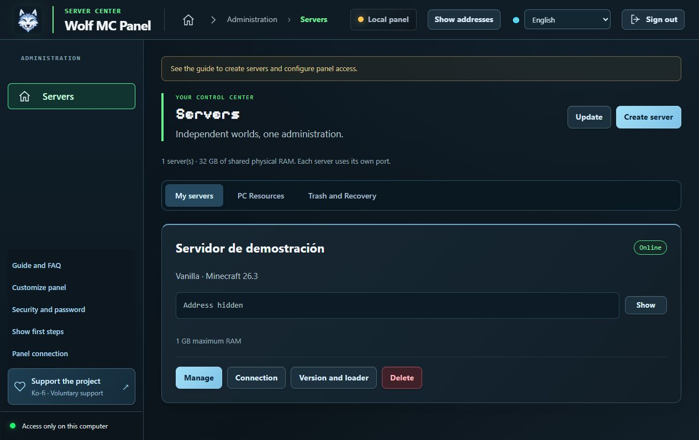

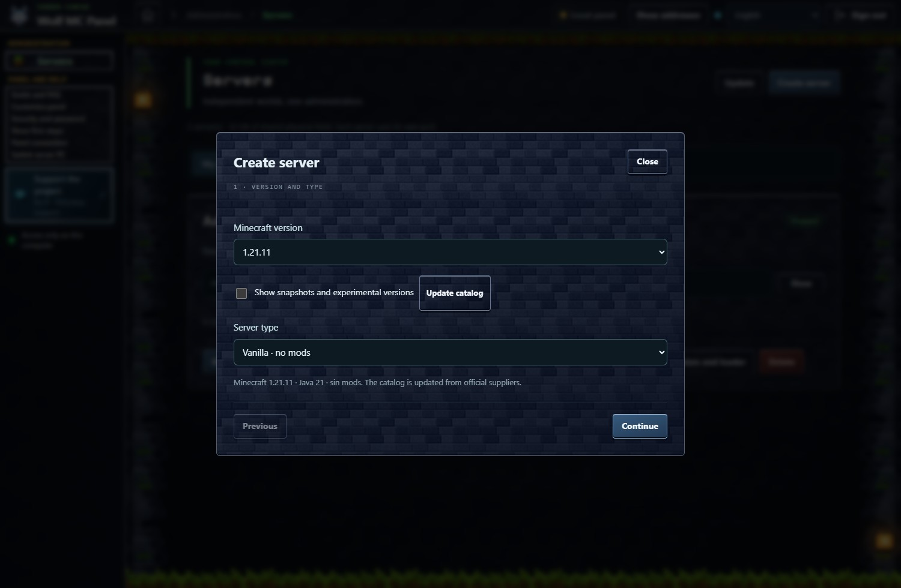

### Apariencia y configuración

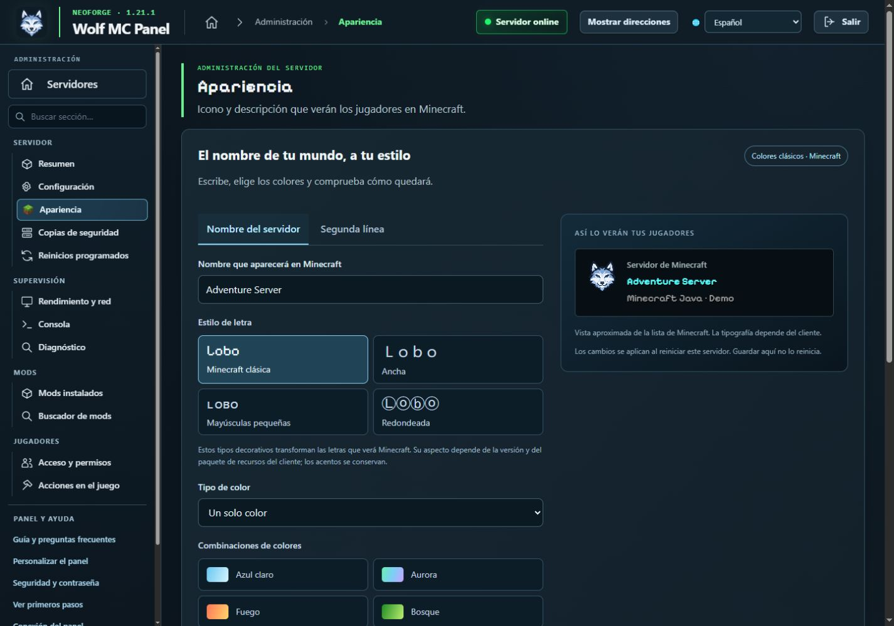

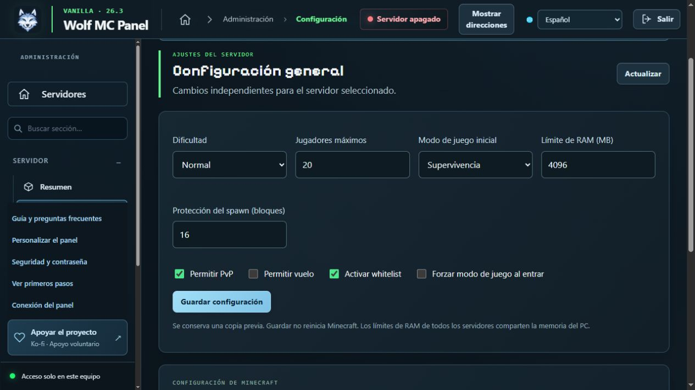

### Jugadores y buscador de objetos

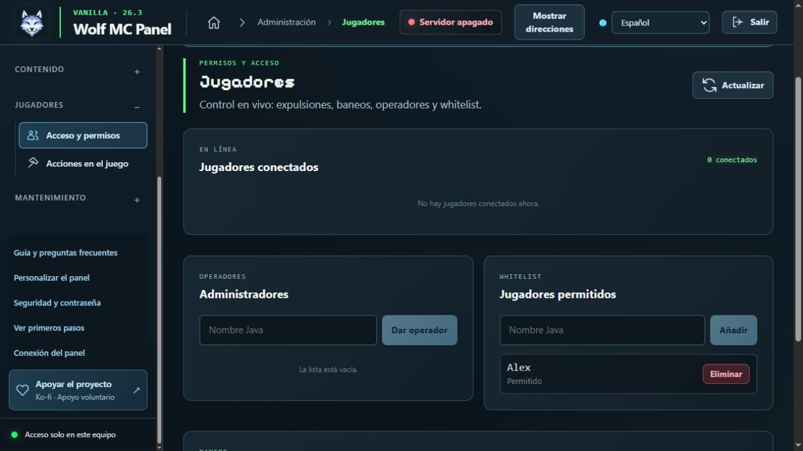

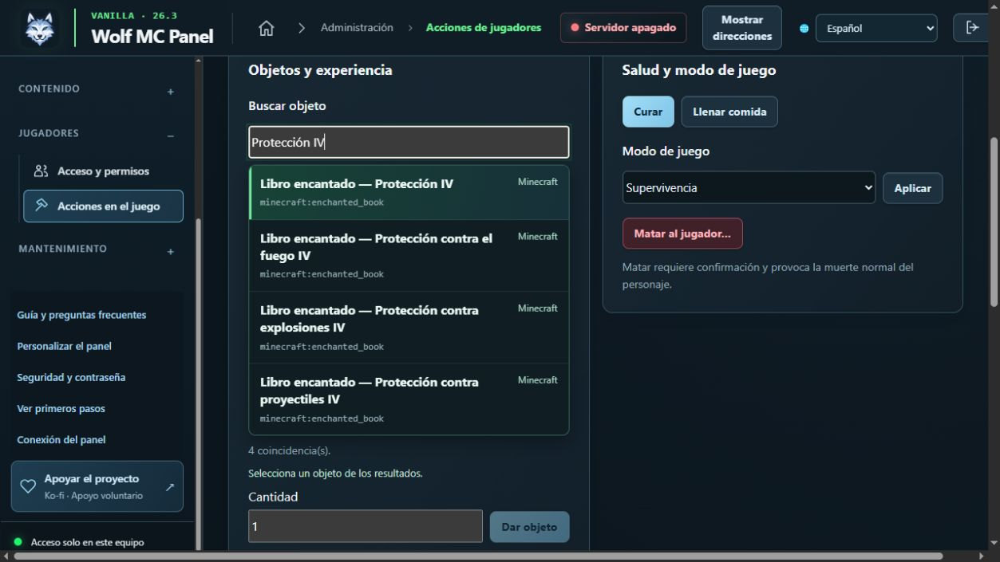

### Rendimiento y ayuda integrada

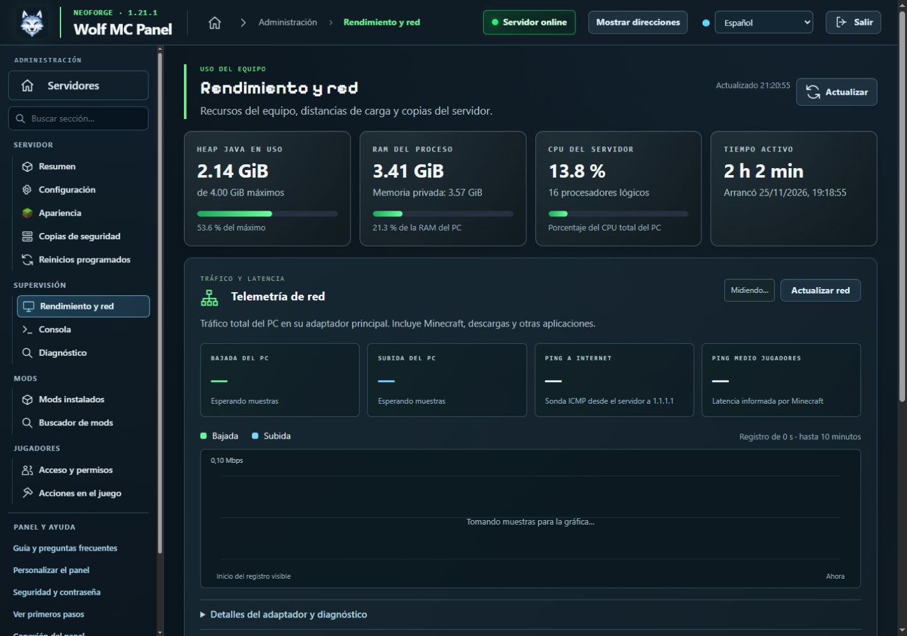

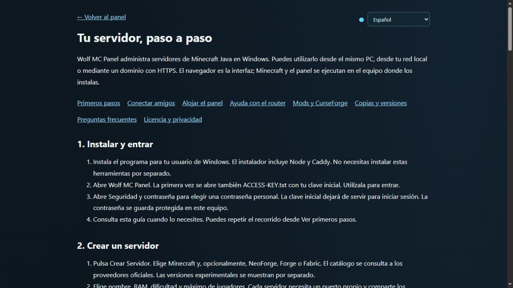

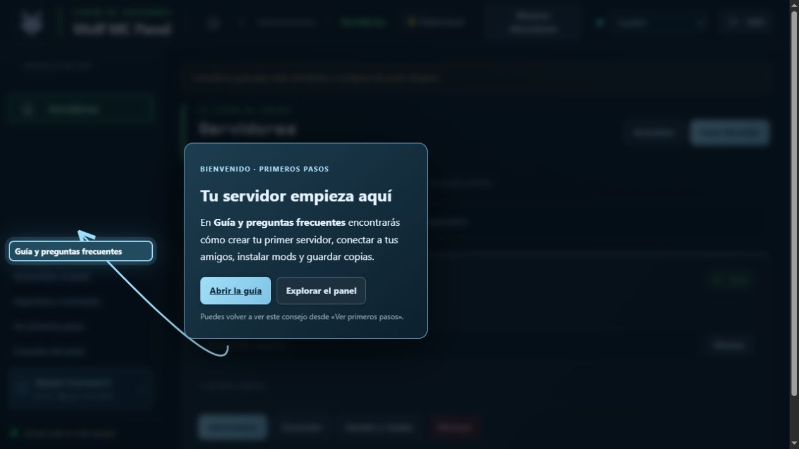

### Recuperación local de contraseña

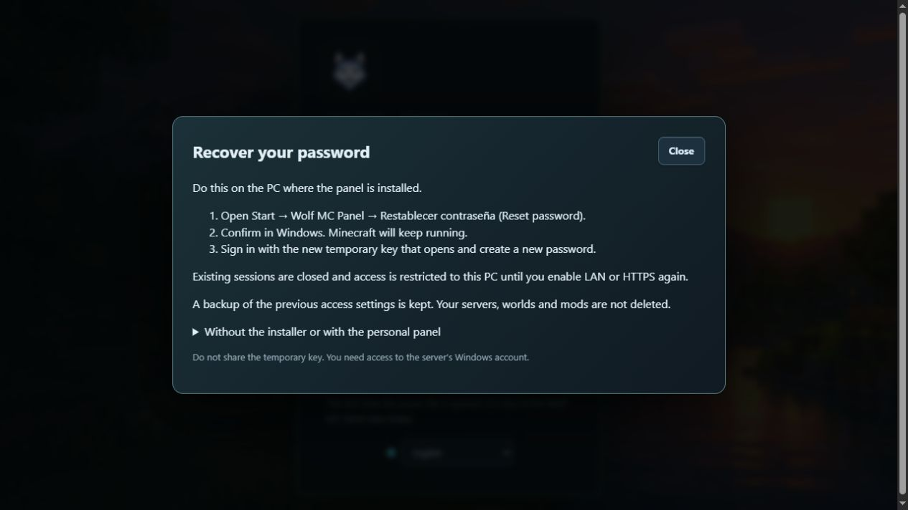

Si olvidas la contraseña, pulsa **He olvidado mi contraseña**. En el PC del servidor, abre **Inicio → Wolf MC Panel → Restablecer contraseña** y confirma la operación. Obtendrás una clave temporal nueva; el acceso quedará limitado a ese PC hasta crear otra contraseña y volver a activar LAN o HTTPS. Los servidores y mundos se conservan.

## Primeros pasos

1. Descarga el instalador oficial de Releases y comprueba su SHA-256 con el archivo de sumas de la misma publicación.
2. Instala para tu usuario y abre Wolf MC Panel. No necesitas permisos de administrador para el uso habitual. Las reglas de firewall pueden necesitar permisos adicionales.
3. Utiliza la clave del archivo ACCESS-KEY.txt que se abre la primera vez. En Seguridad y contraseña puedes elegir una contraseña propia, cuyo hash se guarda en tu equipo. Después la clave inicial deja de servir para entrar.
4. Pulsa Crear Servidor. Elige Minecraft, loader opcional, RAM y conexión. Lee y acepta la EULA de Minecraft si estás de acuerdo. El panel prepara Java y los archivos del servidor.
5. Abre Administrar e inicia el servidor. Prueba primero desde el mismo equipo, después desde tu red local y finalmente desde fuera.

La interfaz empieza en español. El selector permite inglés, alemán, francés, turco y portugués de Brasil. La guía integrada explica cada paso y el tutorial inicial indica dónde encontrarla. El panel recuerda el tutorial visto y la primera visita a la guía: no repite los avisos al volver a entrar ni al cambiar de navegador. Puedes repetir el tutorial desde Ver primeros pasos.

## Funciones

- Varios servidores separados, con mundos, mods, configuración y puertos propios.
- Catálogos de Mojang y loaders NeoForge, Forge y Fabric; consola y controles de inicio, parada y reinicio.
- Whitelist, operadores, expulsiones, bloqueos y acciones en el juego.
- Rendimiento, red, diagnósticos, tareas y registro de acciones. Algunos datos necesitan un puente compatible.
- Mods manuales y buscador CurseForge con dependencias, actualizaciones compatibles y cambios preparados para aplicar al reiniciar.
- Copias manuales y automáticas cada cuatro horas, rotación y restauración con copia del estado anterior.
- Editor visual del nombre y descripción de Minecraft: letras decorativas, colores, degradados y vista previa; icono del servidor y nombre/logo del panel personalizables.
- Acceso local, LAN o dominio HTTPS. Node y Caddy están incluidos en el instalador. También puedes ejecutar el código sin EXE en Windows.

## Tu PC principal y el servidor

Instala el panel donde se ejecuta Minecraft. Desde el principal accede a su dirección web; no necesitas otra instalación para administrarlo. Cerrar el navegador no apaga Minecraft. Detener panel cierra la interfaz y su proxy HTTPS, pero conserva los procesos de Minecraft ya iniciados.

La dirección para jugar y la del panel son diferentes. Un dominio no abre puertos ni evita CG-NAT. Reenvía únicamente los servicios que necesitas y no publiques RCON. El panel incluye ayuda para routers, DDNS y túneles de terceros; su disponibilidad y condiciones dependen de cada proveedor.

## Datos y seguridad

Los datos nuevos se guardan en %LOCALAPPDATA%/WolfMCPanel/data. Las instalaciones anteriores pueden mantener %LOCALAPPDATA%/LoboServerPanel/data. Desinstalar conserva los datos. Guarda una copia independiente en otro disco.

Actualizar Minecraft hace una copia previa, pero no garantiza que los mods admitan el cambio ni recupera contenido de mods eliminados. No uses tu único mundo para probar una migración y no supongas que podrás bajar de versión conservando los avances posteriores.

Para CurseForge necesitas una clave API propia autorizada. La subida manual de JAR no necesita clave. Las instrucciones de solicitud están en la guía y el README. No se distribuyen claves, mundos privados, Minecraft, Java ni modpacks dentro del instalador.

## Código y licencia

La documentación de ejecución desde código, compilación, pruebas y alojamiento está en el [README principal](../README.md) y [HOSTING](HOSTING.md). Solo se anuncia soporte para Windows x64; Linux, Docker y agentes remotos no están incluidos en esta versión.

Código propio bajo AGPL-3.0-only. Se permite modificar y redistribuir cumpliendo la licencia. Los apoyos en [Ko-fi](https://ko-fi.com/lobo97) son voluntarios. Consulta [privacidad](PRIVACY.md), [riesgos](USAGE-AND-RISKS.md), [licencias de terceros](../THIRD-PARTY-NOTICES.md) y [seguridad](../SECURITY.md).

No es un producto oficial de Minecraft ni está aprobado por Mojang o Microsoft. Los avisos no sustituyen una revisión legal aplicable a tu actividad.
